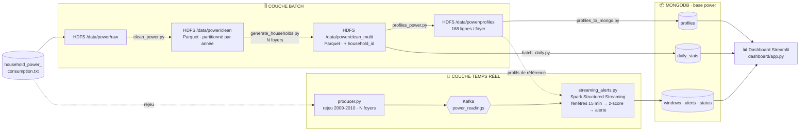

<div align="center">

# ⚡ BigData Power Monitoring

### Surveillance de la consommation électrique de foyers connectés et détection d'anomalies en temps réel
**Architecture Lambda · HDFS · Spark · Kafka · MongoDB · Streamlit**


*Projet du cours **Big Data** — ENSI, II3-IA — réalisé en trinôme*

</div>

---

Le pipeline traite **N foyers en parallèle** (un foyer réel et des foyers synthétiques) et inclut un **test de montée en charge** de la couche batch.

## 📑 Sommaire

1. [Problématique](#1--problématique)
2. [Jeu de données](#2--jeu-de-données)
3. [Multiplication des foyers](#3--multiplication-des-foyers)
4. [Architecture](#4--architecture)
5. [Choix technologiques](#5--choix-technologiques)
6. [Méthode de détection d'anomalies](#6--méthode-de-détection-danomalies)
7. [Structure du dépôt](#7--structure-du-dépôt)
8. [Modèle de données MongoDB](#8--modèle-de-données-mongodb)
9. [Prérequis et installation](#9--prérequis-et-installation)
10. [Exécution pas à pas](#10--exécution-pas-à-pas)
11. [Test de montée en charge](#11--test-de-montée-en-charge)
12. [Dashboard](#12--dashboard)
13. [Résultats](#13--résultats)
14. [Limites et perspectives](#14--limites-et-perspectives)
15. [Répartition du travail](#15--répartition-du-travail)
16. [Contributeurs](#16--contributeurs)

---

## 1 · 🎯 Problématique

Un compteur intelligent produit une mesure de consommation **chaque minute**. Comment repérer **en temps réel** qu'un foyer consomme anormalement (appareil défectueux, appareil énergivore oublié, pic inhabituel), et ce **pour plusieurs foyers à la fois** ?

Une valeur élevée n'est pas forcément anormale : 3 kW est normal le dimanche à 19 h, mais suspect le mardi à 3 h du matin. Il faut donc comparer chaque mesure à **ce qui est normal pour ce foyer, ce jour de la semaine et cette heure**.

> **Notre solution**
> - 🗄️ le **batch** apprend le comportement normal de chaque foyer sur l'historique (un profil de référence par foyer) ;
> - 🌊 le **streaming** compare en continu la consommation entrante de chaque foyer à son profil et lève des alertes ;
> - 📊 le **dashboard** affiche le tout en direct, foyer par foyer.

## 2 · 📚 Jeu de données

[Individual household electric power consumption](https://archive.ics.uci.edu/dataset/235/individual+household+electric+power+consumption) (UCI Machine Learning Repository).

- Un foyer réel, une mesure par minute, de décembre 2006 à novembre 2010
- Séparateur `;`, valeurs manquantes notées `?`
- Nettoyage : **2 049 280 lignes conservées sur 2 075 259**

| Colonne | Description | Unité |
|---|---|---|
| `Date`, `Time` | Horodatage (`dd/mm/yyyy`, `hh:mm:ss`) | |
| `Global_active_power` | Puissance active moyenne du foyer | kW |
| `Global_reactive_power` | Puissance réactive | kW |
| `Voltage` | Tension | V |
| `Global_intensity` | Intensité | A |
| `Sub_metering_1` | Cuisine | Wh |
| `Sub_metering_2` | Buanderie | Wh |
| `Sub_metering_3` | Chauffe-eau et climatisation | Wh |

> Le fichier n'est pas versionné (voir `.gitignore`). Il faut le télécharger depuis le lien ci-dessus.

**Utilisation des périodes**

| Période | Usage |
|---|---|
| 2006-2008 | Calcul des profils de référence (comportement « normal ») |
| 2009-2010 | Rejeu en flux continu via Kafka pour la détection |
| Toutes les années | Statistiques journalières (historique batch) |

## 3 · 🏠 Multiplication des foyers

Le jeu de données ne contient qu'un seul foyer. Pour tester le passage à l'échelle, on fabrique **N foyers** à partir de lui :

- le **foyer 0** est le foyer réel, inchangé ;
- chaque foyer `h ≥ 1` est une copie du foyer réel dont la consommation est :
  - **mise à l'échelle** par un facteur fixe compris entre 0,6 et 1,4 (foyer plus ou moins gourmand) :
    `échelle(h) = 0,6 + 0,8 × ((h × 37) mod 100) / 99`
  - **perturbée** par un bruit multiplicatif gaussien d'environ 5 % (σ = 0,05) à chaque mesure.

Le facteur est appliqué à `Global_active_power`, `Global_reactive_power`, `Global_intensity` et aux trois `Sub_metering`, en conservant la précision d'origine du capteur (ce qui préserve aussi la compression Parquet).

La multiplication est faite à deux endroits :

| Côté | Script | Rôle |
|---|---|---|
| Batch | `batch/generate_households.py` | Produit les données nettoyées de N foyers (`/data/power/clean_multi`) |
| Streaming | `producer/producer.py` | Rejoue les mesures 2009-2010 des N foyers dans Kafka |

> ⚠️ **Le `N` doit être identique des deux côtés**, et la formule du facteur est **dupliquée** dans les deux scripts. Si on la modifie dans l'un, il faut la modifier dans l'autre, sinon les profils batch ne correspondent plus au flux.

**Les dates ne sont pas décalées** entre foyers : le watermark du streaming est global à tous les foyers, qui doivent donc avancer dans le temps au même rythme. Avec `N = 1`, on retrouve exactement la version initiale du projet (un seul foyer).

## 4 · 🏗 Architecture

Architecture Lambda : deux chemins de traitement qui se rejoignent dans MongoDB. Toutes les données portent un identifiant de foyer (`household_id`).



**Flux en résumé**

1. Le fichier brut est chargé dans HDFS, nettoyé par Spark, puis écrit en Parquet.
2. `generate_households.py` multiplie le foyer réel en N foyers (le foyer 0 reste inchangé).
3. Spark batch calcule la consommation « normale » de chaque foyer pour chacune des **168 combinaisons** (jour de semaine × heure), et les statistiques journalières.
4. Le producteur rejoue les mesures 2009-2010 des N foyers dans Kafka, comme N compteurs en direct (la clé du message est l'identifiant du foyer).
5. Spark Structured Streaming agrège le flux par foyer et par fenêtres de 15 minutes, calcule un z-score par rapport au profil du foyer et écrit dans MongoDB.
6. Le dashboard lit MongoDB, permet de choisir le foyer affiché et se rafraîchit automatiquement.

## 5 · 🧰 Choix technologiques

| Technologie | Rôle | Justification |
|---|---|---|
| **HDFS** | Stockage du fichier brut, des données nettoyées et des profils | Stockage distribué et tolérant aux pannes, adapté à des fichiers volumineux (le volume croît avec le nombre de foyers). |
| **Parquet** | Format des données nettoyées | Format colonnaire compressé, lecture rapide par Spark, partitionnement par année. |
| **Spark (batch)** | Nettoyage, multiplication des foyers, profils, agrégats journaliers | Traitement distribué de l'historique complet de tous les foyers. |
| **Kafka** | Transport des mesures en temps réel | Découple le producteur du traitement, rejouable (`startingOffsets: earliest`). |
| **Spark Structured Streaming** | Fenêtrage et détection | Même moteur que le batch, gestion des fenêtres temporelles et du watermark. |
| **MongoDB** | Stockage des résultats servis au dashboard | Schéma flexible (documents de formes différentes : fenêtres, profils, stats), upserts simples, index par foyer pour un filtrage rapide. |
| **Streamlit** | Restitution | Dashboard rapide en Python avec rafraîchissement automatique. |
| **Docker Compose** | Kafka et MongoDB | Déploiement reproductible, avec mémoire plafonnée pour tourner sur une machine modeste. |

## 6 · 🔬 Méthode de détection d'anomalies

Pour chaque foyer et chaque fenêtre de 15 minutes :

1. On calcule la **puissance moyenne** `avg_kw` de la fenêtre.
2. On retrouve, dans le profil de référence **de ce foyer**, la moyenne `mean_kw` et l'écart-type `std_kw` pour le même **jour de semaine** et la même **heure**.
3. On calcule le **z-score** :

$$ z = \frac{\text{avg\_kw} - \text{mean\_kw}}{\text{std\_kw}} $$

4. Si `z > 2.0` (constante `SEUIL` dans `streaming_alerts.py`), la fenêtre est marquée **alerte** et écrite aussi dans la collection `alerts`.

Dans le dashboard, une fenêtre est **critique** si `z ≥ 1,5 × seuil`.

> Convention Spark : `dayofweek` vaut 1 pour dimanche, 2 pour lundi, … 7 pour samedi. Le dashboard applique la même convention.

**Paramètres du flux** : fenêtre de 15 minutes par foyer · watermark de 30 minutes (global à tous les foyers) · mode de sortie `update` · checkpoint dans `/tmp/checkpoint_power` · topic Kafka `power_readings`.

## 7 · 🗂 Structure du dépôt

```text
BigData-Power-Monitoring/
├── docker-compose.yml          # Kafka + MongoDB (mémoire plafonnée)
├── producer/
│   └── producer.py             # Rejeu 2009-2010 de N foyers dans Kafka
├── batch/
│   ├── clean_power.py          # Nettoyage → Parquet partitionné par année
│   ├── generate_households.py  # Multiplication en N foyers
│   ├── profiles_power.py       # 168 profils (jour × heure) par foyer
│   ├── profiles_to_mongo.py    # Profils HDFS → MongoDB
│   └── batch_daily.py          # Statistiques journalières → MongoDB
├── streaming/
│   └── streaming_alerts.py     # Fenêtres 15 min, z-score, alertes
├── scripts/
│   └── scale_test.sh           # Test de montée en charge du batch
└── dashboard/
    └── app.py                  # Interface Streamlit
```

## 8 · 🍃 Modèle de données MongoDB

Base : `power`. Tous les documents (sauf `status`) portent un champ `household_id`.

| Collection | Produite par | Contenu | Clé `_id` | Index |
|---|---|---|---|---|
| `profiles` | `profiles_to_mongo.py` | `household_id`, `dow`, `hour`, `mean_kw`, `std_kw`, `n` (168 documents par foyer) | `"{household_id}-{dow}-{hour}"` | `household_id`, `dow`, `hour` |
| `daily_stats` | `batch_daily.py` | `household_id`, `day`, `kwh`, `max_kw`, `kwh_kitchen`, `kwh_laundry`, `kwh_heating_ac` | `"{household_id}-{YYYY-MM-DD}"` | `household_id`, `day` |
| `windows` | `streaming_alerts.py` | `household_id`, `start`, `avg_kw`, `mean_kw`, `z`, `alert` | `"{household_id}-{début de fenêtre}"` | `household_id`, `start` (décroissant) |
| `alerts` | `streaming_alerts.py` | Mêmes champs que `windows`, uniquement les fenêtres en alerte | `"{household_id}-{début de fenêtre}"` | `household_id`, `start` (décroissant) |
| `status` | `streaming_alerts.py` | `last_write` : date de dernière écriture du job (état du flux) | `"streaming"` | |

Les écritures de `windows`, `alerts` et `status` sont des **upserts** : relancer le streaming ne crée pas de doublons. `profiles` et `daily_stats` sont **vidées puis réécrites** à chaque exécution, pour ne pas garder les foyers d'un ancien essai (par exemple après un changement de `N`).

## 9 · 🛠 Prérequis et installation

### Prérequis

- Docker et Docker Compose
- Un cluster Spark + HDFS (conteneurs du cours, image `liliasfaxi/spark-hadoop:hv-2.7.2`, avec Spark 3.5.1)
- Python 3.9+ sur la machine qui lance le producteur et le dashboard
- Le jeu de données UCI (`household_power_consumption.txt`)

### Réseau Docker partagé

Kafka, MongoDB et les conteneurs Spark/Hadoop communiquent via un réseau externe nommé `hadoop`. S'il n'existe pas :

```bash
docker network create hadoop
```

Les conteneurs Spark/HDFS doivent être attachés à ce même réseau (les jobs Spark joignent `kafka:19092` et `mongo:27017` par leur nom).

### Ressources des conteneurs

| Service | Limite du conteneur | Réglage interne |
|---|---|---|
| `kafka` (`apache/kafka:3.7.0`) | 768 Mo | tas JVM de 512 Mo |
| `mongo` (`mongo:7`) | 512 Mo | cache WiredTiger de 0,25 Go |

Les données MongoDB sont conservées dans le volume Docker `mongo-data`.

### Dépendances Python

```bash
# Producteur
pip install kafka-python

# Dashboard
pip install streamlit pandas plotly pymongo

# Dans le conteneur Spark (jobs qui écrivent dans MongoDB)
pip install pymongo
```

## 10 · ▶️ Exécution pas à pas

> Les commandes `spark-submit` sont à adapter à votre conteneur Spark (nom du conteneur, chemins). Les scripts batch doivent d'abord être copiés dans le conteneur (`docker cp`).

Dans tout ce qui suit, **`N` est le nombre de foyers** (1 = foyer réel seul, comme la version initiale du projet). Choisir la même valeur aux étapes 3 et 5.

### Étape 1 — Démarrer Kafka et MongoDB

```bash
docker compose up -d
```

### Étape 2 — Charger le fichier brut dans HDFS

```bash
hdfs dfs -mkdir -p /data/power/raw
hdfs dfs -put household_power_consumption.txt /data/power/raw/
```

### Étape 3 — Traitements batch (dans l'ordre)

```bash
spark-submit batch/clean_power.py                      # brut -> /data/power/clean
spark-submit --master local[2] --driver-memory 2g \
  batch/generate_households.py N                       # -> /data/power/clean_multi (N foyers)
spark-submit batch/profiles_power.py                   # -> /data/power/profiles
spark-submit batch/profiles_to_mongo.py                # -> Mongo: profiles
spark-submit batch/batch_daily.py                      # -> Mongo: daily_stats
```

Arguments optionnels :

| Script | Arguments | Valeurs par défaut |
|---|---|---|
| `generate_households.py` | `[N] [sortie] [source]` | `N = 20`, sortie `hdfs:///data/power/clean_multi`, source `hdfs:///data/power/clean` |
| `profiles_power.py` | `[source] [sortie]` | source `hdfs:///data/power/clean_multi`, sortie `hdfs:///data/power/profiles` |

`profiles_power.py` doit être exécuté **avant** le streaming : le job temps réel lit `/data/power/profiles`.

### Étape 4 — Lancer le streaming

```bash
spark-submit \
  --packages org.apache.spark:spark-sql-kafka-0-10_2.12:3.5.1 \
  streaming/streaming_alerts.py
```

### Étape 5 — Lancer le producteur

Dans `producer/producer.py`, renseigner le chemin du fichier de données dans la variable `FICHIER`, puis :

```bash
python producer/producer.py N       # sans argument : 1 foyer
```

Pour chaque minute rejouée, le producteur envoie une mesure par foyer, puis attend 0,1 s (paramètre `PAUSE`). Le débit est donc de `N × 10` messages par seconde. Seules les mesures de 2009-2010 sont rejouées.

### Étape 6 — Lancer le dashboard

```bash
python -m streamlit run dashboard/app.py
```

Variables d'environnement optionnelles : `MONGO_URI` (défaut `mongodb://localhost:27017`) et `MONGO_DB` (défaut `power`).

Le dashboard est accessible sur <http://localhost:8501>.

## 11 · 📏 Test de montée en charge

Le script `scripts/scale_test.sh` mesure comment le **batch** (génération des foyers puis calcul des profils) se comporte quand le nombre de foyers augmente.

**Conditions** : à lancer **dans le conteneur `hadoop-master`**, après avoir copié `generate_households.py`, `profiles_power.py` et `scale_test.sh` dans `/root` (`docker cp`). Le dossier `/data/power/clean` doit exister.

```bash
bash scale_test.sh 1 5 20      # nombres de foyers à tester
```

Pour chaque valeur de N, le script :

1. génère N foyers dans `hdfs:///data/power/bench_N` (`spark-submit --master local[2] --driver-memory 2g`) ;
2. calcule les profils à partir de ces données ;
3. mesure la taille sur HDFS et le nombre de blocs ;
4. supprime ses fichiers temporaires.

Il affiche **une ligne CSV par essai** (un foyer nettoyé = 2 049 280 lignes) :

```text
foyers,lignes,taille_hdfs_Mo,blocs,t_generation_s,t_profils_s
```

> Ce test porte uniquement sur le batch. Le streaming n'est pas chronométré par ce script.

## 12 · 📊 Dashboard

Quatre onglets :

| Onglet | Contenu |
|---|---|
| **Temps réel** | État du flux, indicateurs (fenêtres analysées, alertes, dernier z-score, statut), courbe de consommation avec bande normale (± z écarts-types) et alertes, tableau des dernières alertes, alertes par jour |
| **Profil de référence** | Carte de chaleur de la consommation normale (jour × heure), détail d'un jour avec bande normale |
| **Historique batch** | Consommation journalière avec moyenne mobile sur 30 jours, répartition mensuelle par usage (cuisine, buanderie, chauffe-eau/clim, autres) |
| **Pipeline** | Nombre de documents par collection et état attendu de chaque composant (profils attendus : 168 × nombre de foyers), puis alertes par foyer (graphique et tableau) dès qu'il y a plusieurs foyers |

Paramètres dans la barre latérale : **foyer affiché** (le foyer 0 est signalé « réel », les autres « synthétiques »), nombre d'heures affichées, seuil d'alerte (z-score), rafraîchissement automatique et intervalle. Seul l'onglet « Temps réel » se rafraîchit automatiquement. Tous les onglets, sauf « Pipeline » (vue globale), filtrent sur le foyer sélectionné.

La liste des foyers proposés est lue dans la collection `profiles` : il faut donc avoir exécuté `profiles_to_mongo.py` pour les voir apparaître.

## 13 · ✅ Résultats

Le pipeline fonctionne de bout en bout : du fichier brut dans HDFS jusqu'aux alertes affichées en direct, pour un ou plusieurs foyers.

**Exemple d'alerte détectée** (foyer réel) : le 1ᵉʳ mars 2009 à 16 h, la fenêtre mesure une puissance moyenne de **5,73 kW** alors que le comportement attendu pour ce créneau est de **1,31 kW**, soit un **z-score de 3,5**.

**Rejeu 2009-2010 sur le foyer réel** (version initiale, seuil z = 2,0) : 3 272 fenêtres de 15 minutes analysées et 163 alertes levées.

## 14 · 🔭 Limites et perspectives

**Limites**

- Une alerte signale un **comportement inhabituel**, pas nécessairement une panne ou un défaut.
- Un seul foyer réel : les autres foyers sont **synthétiques** (copies mises à l'échelle et bruitées du foyer réel). Ils partagent les mêmes habitudes horaires et ne représentent pas des comportements réellement indépendants.
- La formule de génération des foyers est dupliquée entre `generate_households.py` et `producer.py`, et `N` doit être renseigné à la main des deux côtés.
- Spark exécuté en local (`local[2]` pour le test de charge).
- Le test de montée en charge ne couvre que le batch.
- Le jeu de données ne contient pas d'anomalies étiquetées : la qualité des alertes n'est pas mesurée.
- Le seuil d'alerte est défini à deux endroits (constante `SEUIL` dans le streaming, curseur dans le dashboard).

**Perspectives**

- Injecter des anomalies artificielles pour mesurer le **rappel** et la **précision** de la détection.
- Exécuter Spark sur **YARN**.
- Remplacer les foyers synthétiques par des données de **plusieurs foyers réels**.
- Étendre le test de charge au **streaming** (débit maximal supporté, latence de bout en bout).

## 15 · 🤝 Répartition du travail

| Membre | Responsabilités | Fichiers |
|---|---|---|
| **01** | HDFS, nettoyage, traitements batch, multiplication des foyers, test de charge | `batch/clean_power.py`, `batch/generate_households.py`, `batch/profiles_power.py`, `batch/profiles_to_mongo.py`, `batch/batch_daily.py`, `scripts/scale_test.sh` |
| **02** | Kafka, producteur, Spark Streaming | `producer/producer.py`, `streaming/streaming_alerts.py`, service `kafka` de `docker-compose.yml` |
| **03** | MongoDB, dashboard, Docker | `dashboard/app.py`, service `mongo` de `docker-compose.yml`, `README.md` |

## 16 · 👥 Contributeurs

| Nom | Rôle | Email |
|---|---|---|
| Ranim Latrous | Membre 01 | ranim.latrous@ensi-uma.tn |
| Hadil Bousnina | Membre 02 | hadil.bousnina@ensi-uma.tn |
| Zeineb Kouch | Membre 03 | zeineb.kouch@ensi-uma.tn |

---

<div align="center">

Projet encadré dans le cadre du cours Big Data · **ENSI** (École Nationale des Sciences de l'Informatique) · II3-IA
*Si ce projet vous plaît, une ⭐ fait toujours plaisir !*

</div>
